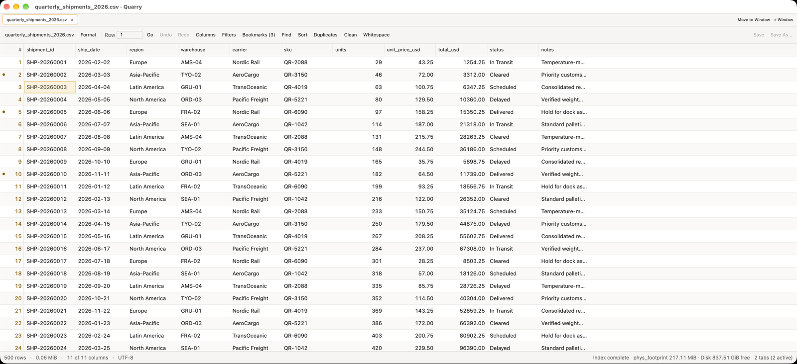
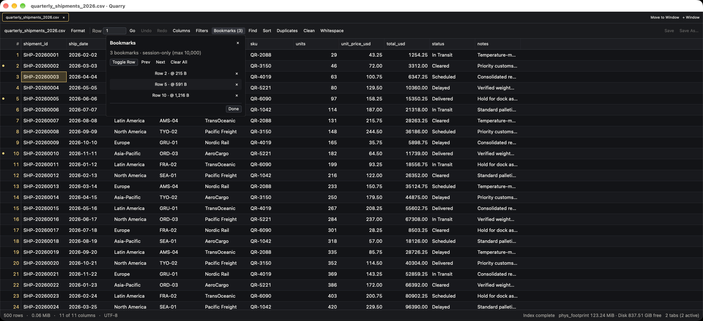
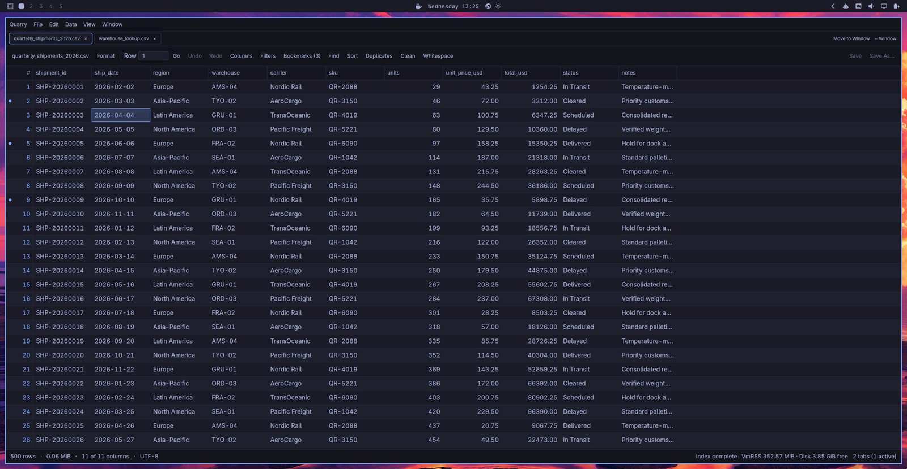

<p align="center">
  
</p>

<p align="center">
  <strong>A free, open-source, GPU-accelerated desktop and CLI editor for multi-gigabyte CSV, TSV, and delimited text files on macOS and Linux (including Omarchy).</strong>
</p>

<p align="center">
  <a href="#download--install"><strong>Download</strong></a> ·
  <a href="https://github.com/danchamorro/quarry/releases">Releases</a> ·
  <a href="LICENSE-MIT">MIT</a> OR <a href="LICENSE-APACHE">Apache-2.0</a> ·
  Zero telemetry &amp; zero network calls ·
  <a href="docs/USER_GUIDE.md">User Guide</a> ·
  <a href="docs/LINUX_AND_OMARCHY.md">Linux &amp; Omarchy</a> ·
  <a href="docs/ROADMAP.md">Roadmap</a> ·
  <a href="https://github.com/danchamorro/quarry/wiki">Wiki</a>
</p>

Quarry opens, searches, filters, cleans, sorts, deduplicates, joins, splices, and edits delimited files that are tens of gigabytes—or terabytes via bounded section windows—without loading the entire file into memory. It is written in native Rust with a GPU-rendered [GPUI](docs/adr/0013-adopt-gpui-desktop-frontend.md) frontend, parallel SIMD structural indexing, bounded out-of-core disk spilling, and atomic file-safety guards.

---

## Download & Install

Prebuilt releases for **macOS (Apple Silicon)** and **Linux / Omarchy (`x86_64` & `arm64`)** are available on [GitHub Releases](https://github.com/danchamorro/quarry/releases) (latest: **[v0.2.0-beta.3](https://github.com/danchamorro/quarry/releases/tag/v0.2.0-beta.3)**)—no Rust toolchain required.

### macOS (Apple Silicon)

1. Download **`Quarry-v0.2.0-beta.3-macos-arm64.dmg`** (or `.zip`) from [GitHub Releases](https://github.com/danchamorro/quarry/releases/tag/v0.2.0-beta.3).
2. Open the `.dmg` and drag **Quarry** into **Applications** (or if you downloaded the `.zip`, extract it and move `Quarry.app` into **Applications**).
3. Launch **Quarry**—official releases are Developer ID signed, Apple-notarized, and stapled.

Optionally download `SHA256SUMS-macos-arm64.txt` into the same directory and verify your download from there with `grep '\.dmg$' SHA256SUMS-macos-arm64.txt | shasum -a 256 -c -` (or `\.zip$` for the ZIP).

### Linux & Omarchy (`x86_64` & `arm64`)

1. Download **`Quarry-v0.2.0-beta.3-linux-x86_64.tar.gz`** (most desktops/laptops) or **`Quarry-v0.2.0-beta.3-linux-arm64.tar.gz`** along with its matching `SHA256SUMS-linux-*.txt` from [GitHub Releases](https://github.com/danchamorro/quarry/releases/tag/v0.2.0-beta.3).
2. From the directory containing the downloaded files, verify, extract, and run the included user installer (no `sudo` required):

```bash
ARCH="x86_64" # or "arm64"
ARCHIVE="Quarry-v0.2.0-beta.3-linux-${ARCH}.tar.gz"
awk -v archive="$ARCHIVE" 'substr($0, 67) == archive' "SHA256SUMS-linux-${ARCH}.txt" | sha256sum -c - &&
  tar -xzf "$ARCHIVE" &&
  cd "${ARCHIVE%.tar.gz}" &&
  ./install.sh
```

This installs the GPU-rendered desktop app (`~/.local/bin/quarry-gpui`), the headless CLI (`~/.local/bin/quarry`), an XDG launcher entry (**Quarry** in Omarchy's app launcher / Walker and *"Open With"* for `.csv`/`.tsv`), the app icon, and third-party notices into `~/.local/bin` and `${XDG_DATA_HOME:-~/.local/share}`. On Omarchy, choose **View → Theme → Omarchy** to follow your active theme live. To uninstall cleanly (keeping `~/.config/quarry`), run `"${XDG_DATA_HOME:-$HOME/.local/share}/doc/quarry/uninstall.sh"`.

See the [Linux & Omarchy Guide](docs/LINUX_AND_OMARCHY.md) for Wayland/Hyprland, theme sync, system-wide `--prefix /usr/local` installs, and AT-SPI accessibility, or jump to [Build from Source](#build-from-source) below.

---

## Screenshots

### macOS — Light Theme
*Clean grid with right-aligned tabular numeric typography, session row bookmarks (`Bookmarks (3)`), and the Live Resource HUD (`phys_footprint`, free disk, active tabs).*



### macOS — Dark Theme & Session Row Bookmarks
*WCAG AA Dark palette with the floating `Bookmarks` popover showing byte-offset anchors for quick navigation across large files.*



### Linux / Omarchy — Native Wayland on Hyprland
*Native Wayland rendering (`xwayland: false`) with live Omarchy theme sync (`tokyo-night`), Linux in-window menu bar, multi-tab workspace, and live `VmRSS` telemetry.*



---

## Free, Open Source, and Local-First

- **Dual-licensed under [MIT](LICENSE-MIT) OR [Apache-2.0](LICENSE-APACHE):** Quarry is completely free and open source. Every feature is available in source builds and official releases free of charge—no paid editions, no license keys, no paywalled features, and no Contributor License Agreement (CLA).
- **100% local execution, zero telemetry:** Quarry makes zero network requests and collects zero telemetry. Release dependency graphs across four build targets, linked binaries, and live offline socket audits verify zero HTTP/TLS/network transport dependencies ([v1.0 Claim Ledger](docs/V1_CLAIM_LEDGER.md)).
- **Audited third-party attribution:** All bundled third-party notices are checked in and verified under [`packaging/licenses/`](packaging/licenses/AUDIT.md).

---

## What Quarry Can Do Today

| Area | Capabilities on `main` |
|---|---|
| **Desktop & Platforms** | Native GPU-rendered Rust app (`apps/quarry-gpui`) for **macOS** and **Linux / Omarchy** (native Wayland / Hyprland, crisp fractional scaling, XDG portals, AccessKit accessibility on macOS and Linux AT-SPI). |
| **Themes & Typography** | Built-in **Light**, WCAG AA **Dark**, **System**, and hardened live **Omarchy** theme sync (`View → Theme`). Right-aligned OpenType `tnum` tabular numeric columns and configurable `Show All Whitespace` inspection. |
| **Multi-Window & Scale** | Single-process multi-window workbench supporting **up to 200 open tabs** with automatic dormant-tab eviction and a strict `< 128` open-file-descriptor cap. |
| **Engine & Indexing** | Parallel positional `pread`/`seek_read` I/O (no `mmap` on user source files, preventing `SIGBUS` on external truncation), 64-byte SIMD (Apple Silicon NEON / x86_64 AVX2) structural indexing, and an optional privacy-preserving **persistent sidecar index cache** (owner-only `0700`/`0600`, stores only offsets and hashes—never filenames or cell text). |
| **Large-File Control & Sections** | **Pause / Resume Indexing** without blocking background threads, a **Live Resource HUD** (`phys_footprint` / `VmRSS` and per-volume free disk), and **Open Section…** (`Bytes`–`TiB`, verified on a 20 TiB sparse file) with outward line-boundary snapping, `Verified` vs `Speculative` trust badges, **Verify Section Boundary**, **Save Section As New File**, and `Verified`-only **Guarded Section Splice-Save** (APFS CoW / Linux `FICLONE` with streaming fallback). |
| **Navigation & Bookmarks** | Direct `Row → Go`, Page Up/Down, and **Session Row Bookmarks** (up to 10,000 bookmarks per document, `#` gutter markers, `Bookmarks` popover, `Cmd/Ctrl+B`, `Cmd/Ctrl+]`, `Cmd/Ctrl+[`, preserved across cell edits, row inserts/deletes, filters, and tab dormancy). |
| **Editing & Safety** | Direct cell editing (including multiline values), header renaming, **Undo / Redo**, atomic **Save / Save As / Save As UTF-8**, **Discard Changes**, source-modification conflict detection, and **Inspect File & Recovery…** for broken or malformed records. |
| **Search & Filtering** | Overlay-aware literal **Find**, **Replace in Cell**, and **Replace All**; multi-column **Filters** with text (`Contains`, `Equals`, `Does not equal`) and exact arbitrary-precision decimal numeric rules (`>`, `>=`, `<`, `<=`, `Between`), plus **Export Filtered…**. |
| **Out-of-Core Transforms** | Adaptive **300 MB** in-RAM fast path with automatic bounded out-of-core disk spilling and a persisted scratch directory (`File → Temporary Storage…`). Stable multi-column **Sort** (1–16 levels: Text, exact Number, Natural, Date / time, Character count, Word count, Shuffle, Reverse), **Find & Remove Duplicates** (selected columns or whole rows), **Clean Selected Columns** (Trim, Collapse spaces, Uppercase, Lowercase, Fill empty), **Split**, **Combine**, **Move**, **Insert**, and **Delete** rows or columns. |
| **Multi-File & Formats** | **Combine Files…** (exact-schema streaming append), **Join Files…** (Inner, Left, Right, Full with preview and partitioned multi-threaded hash-join + sort-merge skew fallback), direct **`.csv.gz`** reading, and **UTF-8**, **UTF-16 LE/BE**, **Windows-1252**, and **ISO-8859-1** encodings. |

---

## Verified Benchmarks

Measured on real public ClickHouse datasets (`weather`, **9.10 GiB**, 131,990,024 rows; `hacker-news`, **11.84 GiB**, 28,737,558 rows) and synthetic join suites using the headless `quarry-cli` engine on Apple M3 Max (warm OS page cache, `--threads 8`), with 14/14 golden SHA-256 output parity against the Phase 1 single-threaded baseline.

| Workload | Weather (9.10 GiB · 132.0M rows) | Hacker News (11.84 GiB · 28.7M rows) | Peak RSS |
|---|---:|---:|---:|
| **First 100 rows (bootstrap)** | `0.787 ms` | `0.772 ms` | `4.6 MiB` |
| **Full structural index (cold sidecar miss)** | `0.311 s` (`29.22 GiB/s`) | `0.472 s` (`25.12 GiB/s`) | `20.2–25.0 MiB` |
| **Sidecar cache hit + seek to row 100M / 20M** | `19.1 ms` wall (`4.4 ms` cache load) | `20.8 ms` wall (`5.5 ms` cache load) | `5.1–6.2 MiB` |
| **Random 100-row viewport read (p95)** | `0.231 ms` | `0.325 ms` | — |
| **Find (absent literal scan)** | `0.303 s` | `0.510 s` | `14.5–23.0 MiB` |
| **Multi-column AND Filter** | `1.086 s` | `1.617 s` | `17.5–21.8 MiB` |
| **Replace All (full rewrite)** | `2.800 s` op / `3.121 s` cmd (`60.2×` cmd vs Phase 1) | `2.760 s` op / `3.207 s` cmd (`14.0×` cmd vs Phase 1) | `178.9–193.2 MiB` |
| **Stable Number Sort (out-of-core)\*** | `50.968 s` op / `146.046 s` cmd (`5.51×` cmd vs Phase 1) | `38.974 s` op / `90.254 s` cmd (`1.89×` cmd vs Phase 1) | `164.5–172.1 MiB` |
| **Delete Duplicates (out-of-core)** | `120.677 s` op / `121.441 s` cmd (`2.18×` cmd vs Phase 1) | `74.870 s` op / `75.822 s` cmd (`4.66×` cmd vs Phase 1) | `174.3–194.3 MiB` |

*\*Note: For Stable Number Sort, `quarry-bench sort-save-as` runs an independent post-sort full-file re-index and dual-fingerprint verification pass inside the command time (`146.046 s` Weather / `90.254 s` Hacker News); the parallel sort operation wall times alone are `50.968 s` and `38.974 s`. Speedup ratios compare whole-command wall times against the matched Phase 1 single-threaded baseline.*

Partitioned multi-threaded **Hash-Join** (with automatic sort-merge skew fallback, 100% SHA-256 oracle parity):
- **18 GiB large join:** `19.40 s` (`4.99×` faster than sort-merge baseline), `16.30 MiB` peak RSS, `9.68 GB` peak temp disk.
- **10M rows/side narrow join:** `12.49 s` (`33.8×` faster than sort-merge baseline), `490.52 MiB` peak RSS (under the 512 MiB cap).

<details>
<summary>Benchmark methodology, reports, and full evidence archive</summary>

- All Phase 2 & 3 CLI measurements above were run on bare-metal Apple M3 Max (warm cache, 8 workers) with full environment metadata and SHA-256 parity tables:
  - [Phase 2 engine benchmarks (SIMD indexing, sidecar cache, parallel find/filter)](docs/benchmarks/2026-11-21-phase2-engine-benchmarks.md)
  - [Phase 3 out-of-core benchmarks (parallel sort, dedup, replace-all, 300 MB budget, hash-join)](docs/benchmarks/2026-11-22-phase3-out-of-core-benchmarks.md)
  - [Phase 4B-3 GPUI cutover verification (macOS ARM64 & Linux/Omarchy Wayland, 200-tab RSS/FD, AT-SPI/AccessKit, zero-socket audit)](docs/benchmarks/2026-11-23-phase4b3-gpui-cutover-verification.md)
  - [Public ClickHouse dataset setup and reproduction commands](docs/BENCHMARK_DATASETS.md)
- Historical single-threaded baselines and earlier capability reports:
  - [2026-09-11 public ClickHouse single-threaded baseline](docs/benchmarks/2026-09-11-public-datasets.md)
  - [50 GB capability suite](docs/benchmarks/2026-08-22-50gb-capability-suite.md)
  - [Compressed `.csv.gz` validation](docs/benchmarks/2026-11-20-compressed-files.md)
  - [All benchmark & validation reports (`docs/benchmarks/`)](docs/benchmarks/)

</details>

---

## Build from Source

Quarry pins its Rust toolchain in [`rust-toolchain.toml`](rust-toolchain.toml) (currently **Rust `1.100.0`**). Install `rustup` first if you do not have it.

### macOS (from Source)

Build, package, install into `/Applications/Quarry.app`, and verify the local bundle:

```bash
git clone https://github.com/danchamorro/quarry.git
cd quarry
./scripts/macos-app.sh install
./scripts/macos-app.sh verify
open /Applications/Quarry.app
```

See [macOS Packaging & Verification](docs/MACOS_PACKAGING.md) for ad-hoc vs Developer ID signing, rollback archives (`./scripts/macos-app.sh rollback`), and third-party license bundling.

### Linux & Omarchy (from Source)

Build and install the desktop app, CLI, `.desktop` entry, and icon into `~/.local` in one command:

```bash
git clone https://github.com/danchamorro/quarry.git
cd quarry
./scripts/linux-app.sh install
```

See the [Linux & Omarchy Guide](docs/LINUX_AND_OMARCHY.md) for system build dependencies on Arch/Omarchy and Ubuntu/Debian.

### CLI (`quarry-cli`)

The prebuilt Linux bundle installs `quarry` automatically into `~/.local/bin/quarry`. To build the headless CLI directly from source on macOS or Linux:

```bash
cargo build --release -p quarry-cli --locked
./target/release/quarry --help
```

---

## What's Next

Quarry is actively working toward v1.0. High-level upcoming areas include:

- **Streaming & Live Files:** Opt-in append-only **Live Watch Mode** for growing logs and exports.
- **Power-User UX & Querying:** Interactive `/` regex & expression query bar, keyboard-first navigation (`hjkl`, `gg`, `G`) and fuzzy Command Palette (`Cmd/Ctrl+K`), Cell Inspector Drawer for embedded JSON/Markdown/stack traces, Smart Copy (`CSV`, `Markdown`, `JSON`, `SQL IN`), multi-row freeze & column pinning, async column summary headers, Focus Mode, and custom TOML themes.
- **File Split, Combine & Format Conversion:** Guided File Splitter (every N rows or at bookmarked rows with header/footer injection), Combine Files v2 (opt-in column alignment, schema-drift flagging, `_source_file` column), `.csv.zst` support, format converters (`CSV`/`TSV`/`PSV`/`JSON`/`NDJSON`/`Markdown`), and reusable custom CSV format profiles.
- **Analysis & Data Tools:** Out-of-core Pivot Tables (`SUM`, `AVG`, `COUNT`, `MIN`, `MAX`), Autofill (series/dates) & Flash Fill by example, Combine Lines rollup, Transpose, and Extract Frequent Strings.
- **Cross-Platform Packaging & Release Verification:** Signed/notarized macOS builds (Apple Silicon and Intel), Linux packages, bare-metal 120 Hz & accessibility verification, and full [v1.0 Claim Ledger](docs/V1_CLAIM_LEDGER.md) reconciliation.

Track active issues and priorities in the [Roadmap](docs/ROADMAP.md) and the [Quarry GitHub Project](https://github.com/users/danchamorro/projects/1).

---

## Documentation

- [User Guide](docs/USER_GUIDE.md) — complete desktop workflows, shortcuts (macOS & Linux), filters, sorting, sections, bookmarks, and safety guards
- [Linux & Omarchy Guide](docs/LINUX_AND_OMARCHY.md) — building, native Wayland/Hyprland ergonomics, live Omarchy theme sync, and AT-SPI
- [macOS Packaging Guide](docs/MACOS_PACKAGING.md) — bundling, verification, rollback, and signing
- [Architecture](docs/ARCHITECTURE.md) — streaming engine, parallel positional I/O, SIMD indexing, sidecar cache, bounded memory, and atomic saves
- [Design System](docs/DESIGN.md) — Light, Dark, and Omarchy semantic palettes, GPUI layout, typography, and accessibility
- [Architecture Decision Records (`docs/adr/`)](docs/adr/) — key technical decisions (`ADR 0001`–`ADR 0015`)
- [v1.0 Claim Contract Ledger](docs/V1_CLAIM_LEDGER.md) — quantitative and behavioral engineering contracts with evidence links
- [Roadmap](docs/ROADMAP.md) & [Changelog](CHANGELOG.md)
- [Contributing](docs/CONTRIBUTING.md) & [GitHub Wiki](https://github.com/danchamorro/quarry/wiki)

---

## License

Dual-licensed under [MIT](LICENSE-MIT) OR [Apache-2.0](LICENSE-APACHE), at your option. Third-party notices are maintained in [`packaging/licenses/THIRD_PARTY_NOTICES.html`](packaging/licenses/THIRD_PARTY_NOTICES.html) and audited in [`packaging/licenses/AUDIT.md`](packaging/licenses/AUDIT.md).
