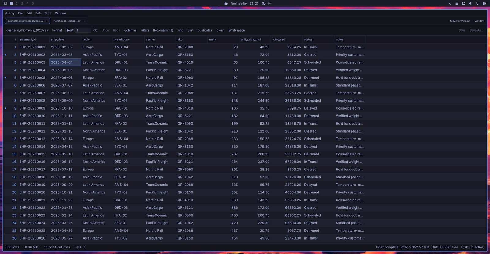

# Quarry on Linux and Omarchy

Quarry runs natively on Linux (`x86_64` and `arm64`) and [Omarchy](https://omarchy.org/) as a GPU-accelerated **Wayland** application built with Rust and GPUI (`apps/quarry-gpui`).



## Highlights on Linux & Omarchy

- **Native Wayland & Hyprland (`xwayland: false`):** No XWayland blur. Supports fractional display scaling (`1.2×`, `1.5×`, `2.0×`) and tiling window manager ergonomics cleanly.
- **Live Omarchy theme sync:** Select **View → Theme → Omarchy** to follow your active Omarchy theme automatically. Theme changes reload live without restarting Quarry.
- **Native desktop integration:** Uses XDG desktop portals for file pickers, in-window application menus (`Quarry`, `File`, `Edit`, `Data`, `View`, `Window`), and Linux **AT-SPI** (`accesskit_unix`) accessibility.
- **Live Resource HUD:** Displays real-time Linux `VmRSS` alongside per-volume free disk space and active/dormant tab counts.
- **CoW section splice-save:** Uses Linux `FICLONE` copy-on-write reflinks when supported by the filesystem (such as Btrfs or XFS), with a bounded streaming fallback on ext4 and other filesystems.
- **100% local-first:** Zero outbound network sockets and zero telemetry.

---

## Building from Source

Quarry pins its Rust toolchain in [`rust-toolchain.toml`](../rust-toolchain.toml) (currently **Rust `1.100.0`**).

### 1. System Dependencies

GPUI on Linux uses Wayland, Vulkan, XKB, fontconfig/FreeType, and standard desktop portal libraries.

On **Arch Linux / Omarchy**:

```bash
sudo pacman -S --needed base-devel pkgconf clang cmake \
  wayland libxkbcommon vulkan-icd-loader fontconfig freetype2 \
  libxcb libx11 libxcursor libxrandr libxi libglvnd
```

On **Ubuntu / Debian**:

```bash
sudo apt-get update
sudo apt-get install -y build-essential pkg-config clang cmake \
  libwayland-dev libxkbcommon-dev libxkbcommon-x11-dev \
  libvulkan-dev libfontconfig1-dev libfreetype-dev \
  libxcb1-dev libxcb-render0-dev libxcb-shape0-dev libxcb-xfixes0-dev \
  libssl-dev
```

*(Note: Quarry itself does not link OpenSSL/TLS into its shipping app; install a Vulkan driver for your GPU or `mesa` / `vulkan-swrast` in virtual machines.)*

### 2. Build & Run

```bash
git clone https://github.com/danchamorro/quarry.git
cd quarry
cargo build --release -p quarry-gpui --locked
./target/release/quarry-gpui
```

Open one or more files directly from the command line:

```bash
./target/release/quarry-gpui /path/to/data.csv /path/to/lookup.tsv
```

Build the headless CLI as well:

```bash
cargo build --release -p quarry-cli --locked
./target/release/quarry-cli --help
```

---

## Live Omarchy Theme Sync

When **View → Theme → Omarchy** is selected:

- Quarry reads the active Omarchy theme from your local Omarchy directories (`~/.config/omarchy`, `~/.local/share/omarchy`, and `~/.local/state/omarchy`).
- Symlink targets are validated against that allowlist (preventing symlink-escape reads outside Omarchy's local theme directories), and theme files are capped at **64 KiB**.
- Quarry derives a full WCAG-checked semantic palette (canvas, chrome, zebra rows, selection, accent, and status indicators) from the active Omarchy palette and watches for theme generation updates so switching Omarchy themes updates open Quarry windows live.
- If no Omarchy theme is installed on a non-Omarchy Linux desktop, Quarry falls back cleanly to its built-in **Dark** palette.

Your chosen theme preference (`system`, `light`, `dark`, or `omarchy`) is persisted locally under `$XDG_CONFIG_HOME/quarry/theme.pref` (defaulting to `~/.config/quarry/theme.pref`).

---

## Linux Keyboard Shortcuts

Quarry uses `Ctrl` on Linux where macOS uses `Command`:

| Action | Linux Shortcut |
|---|---|
| New Window | `Ctrl+N` |
| Open File | `Ctrl+O` |
| Open Section… | `Ctrl+Shift+O` |
| Close Tab / Close Window | `Ctrl+W` / `Ctrl+Shift+W` |
| Next / Previous Tab | `Ctrl+Tab` / `Ctrl+Shift+Tab` |
| Save / Save As… | `Ctrl+S` / `Ctrl+Shift+S` |
| Reload from Disk | `Ctrl+R` |
| Undo / Redo | `Ctrl+Z` / `Ctrl+Shift+Z` |
| Copy Selection | `Ctrl+C` |
| Edit Selected Cell | `F2` or `Enter` |
| Find / Find Next / Find Previous | `Ctrl+F` / `Ctrl+G` / `Ctrl+Shift+G` |
| Replace… | `Ctrl+H` |
| Toggle Row Bookmark | `Ctrl+B` |
| Next / Previous Row Bookmark | `Ctrl+]` / `Ctrl+[` |
| Quit Quarry | `Ctrl+Q` |

---

## Accessibility (AT-SPI) & Wayland Notes

- **AT-SPI:** Quarry exposes its window, grid, toolbar, dialogs, status badges, and live announcements through `accesskit_unix` over the session AT-SPI bus.
- **Wayland vs XWayland:** On Hyprland and other Wayland compositors, Quarry runs natively on Wayland without XWayland. You can confirm this on Hyprland with `hyprctl clients -j` (`"xwayland": false` for class `dev.quarry.gpui`).
- **Software Vulkan in VMs:** Inside headless or virtualized Linux guests without a passthrough GPU, Mesa's `llvmpipe` Vulkan ICD works out of the box (though frame pacing reflects software rendering rather than hardware GPU performance).
- **Prebuilt Linux packages:** Prebuilt Linux packages are planned for v1.0 after cross-platform packaging and bare-metal verification complete ([Roadmap](ROADMAP.md), [v1.0 Claim Ledger](V1_CLAIM_LEDGER.md)). Building from source is currently the supported way to run Quarry on Linux and Omarchy.
